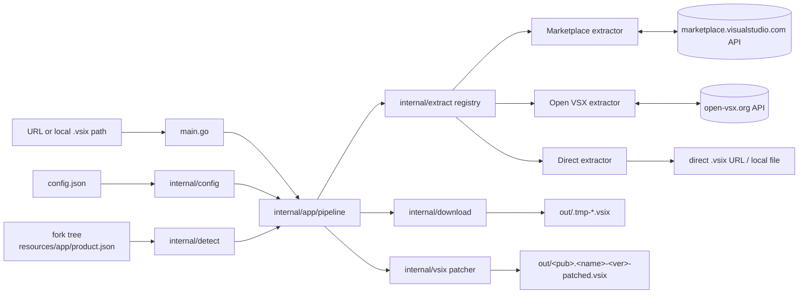

# ARCHITECTURE_PLAN_zen-vsix

## Summary

`zen-vsix` is a single-binary Go CLI that takes **any supported store URL** and produces a VSIX compatible with a local VS Code fork: it resolves the URL to a downloadable `.vsix` (yt-dlp-style modular extractors), downloads it, and — only when the extension's `engines.vscode` requirement exceeds the fork's API version — rewrites the zip in a single streaming pass that recompresses **only** `extension/package.json` while byte-copying every other entry raw (no full extraction, no temp tree, O(manifest) memory). The fork's engine version is auto-detected from `product.json` (verified: Antigravity at `/media/jang/home/PortableApp/antigravity/resources/app/product.json` reports `1.107.0`), with a `force_engine_version` escape hatch. Built because extensions are released against newer VS Code engines than forks (Antigravity, Codex, Claude Desktop) ship, and the demonstrated `patch.sh` works but does a full unzip→edit→re-zip cycle (recompressing all 22 MB).

## System boundaries

```
zen-vsix <URL-or-local-vsix-path>  [--engine-version X] [-o out] [-k] [--no-patch] [-c config.json]
```

```
┌──────────────────────────── zen-vsix binary ────────────────────────────┐
│ main.go ──► internal/app/pipeline.go ──► Result (printed summary)      │
│    │              │                                                      │
│    │              ├─► internal/config  (config.json → Config)           │
│    │              ├─► internal/detect (fork root → engine version)      │
│    │              ├─► internal/extract (registry → extractor → Artifact)│
│    │              ├─► internal/download (Artifact.URL → .vsix file)     │
│    │              └─► internal/vsix (manifest read + zip patch + verify)│
└──────────────────────────────────────────────────────────────────────────┘
        │                    │                  │                   │
   config.json          fork tree          store APIs            out/ dir
   (project root)   (vscode_path)    MS Marketplace │ Open VSX   (portable)
```



## Data flow and state management

```mermaid
sequenceDiagram
    participant U as User
    participant M as main.go
    participant P as pipeline.Run
    participant E as extractor
    participant D as downloader
    participant V as vsix patcher
    U->>M: zen-vsix <URL>
    M->>P: Run(ctx, URL, Options)
    P->>P: load config.json; resolve engine target<br/>(force_engine_version > CLI flag > detect fork)
    P->>E: extract.ForURL(URL) → Extract(ctx, URL)
    E-->>P: Artifact{publisher, name, version, directURL, localPath?}
    alt remote artifact
        P->>D: Download(directURL, out/.tmp-<rand>.vsix)
    else local .vsix path
        P->>P: input file is already the vsix
    end
    P->>V: ReadManifest(vsix) → engines.vscode
    alt constraint NOT satisfied by fork version
        P->>V: PatchVSIX(src, out/&lt;pub&gt;.&lt;name&gt;-&lt;ver&gt;-patched.vsix)
        P->>V: VerifyPatched(out, wantEngine)
    else satisfied or --no-patch
        P->>P: keep original; no rewrite (rename if remote)
    end
    P-->>M: Result{patched?, engines before/after, bytes}
    M-->>U: human-readable summary
```

**State management:** deliberately stateless. No cache, no DB, no lock files — each invocation resolves "latest" fresh, downloads to a temp file, and atomically renames into place. The only persistent artifacts are `config.json` (user-owned) and files in `out/`. Deterministic for a given URL + fork version.

## Implementation Blueprint

All paths relative to project root `/media/jang/home/Deve/zen-vsix/`. Module name: `zen-vsix`, `go 1.23`, single external dep: `github.com/Masterminds/semver/v3` (constraint *evaluation* — `golang.org/x/mod/semver` can only canonicalize, not check `^1.85.0 || ^1.86.0`-style constraints).

### Ordered build steps

| # | File path | Action | Concrete signature / schema | Depends on | Acceptance criteria ("done when") |
|---|-----------|--------|------------------------------|------------|-----------------------------------|
| 1 | `go.mod` | create | `module zen-vsix`, `go 1.23`, require `github.com/Masterminds/semver/v3 v3.x` | — | `go build ./...` and `go vet ./...` pass on a stub tree |
| 2 | `internal/config/config.go` | create | `type Config struct { VSIXPath string \`json:"vscode_path"\`; OutputDir string \`json:"output_dir"\`; ForceEngineVersion string \`json:"force_engine_version"\`; PatchManifest bool \`json:"patch_manifest"\`; Overwrite bool \`json:"overwrite"\` }`; `func Default() *Config`; `func Load(path string) (*Config, error)` (missing file → `Default`, invalid JSON → error); `func (c *Config) ResolveOutputDir() (string, error)` — **resolves relative to config.json's directory, not CWD** (portability requirement) | 1 | Unit tests: defaults; relative `output_dir` resolves against config dir; malformed JSON returns error |
| 3 | `internal/detect/version.go` | create | `func DetectEngineVersion(appRoot string) (string, error)` — probes in order: `<root>/resources/app/product.json`, `<root>/resources/app/package.json`, `<root>/product.json`, `<root>/package.json`; reads `version`, canonicalizes via semver (strips `v`/pre-release kept), returns `"1.107.0"`; `var ErrNoProduct = errors.New(...)` when nothing found | 2 | Unit test with temp fixture tree: Antigravity layout → `"1.107.0"`; empty dir → `ErrNoProduct` |
| 4 | `internal/extract/extractor.go` | create | `type Artifact struct { Publisher, Name, Version string; DirectURL string; LocalPath string; Source string }`; `type Extractor interface { Name() string; Priority() int; Pattern() *regexp.Regexp; Extract(ctx context.Context, rawURL string) (*Artifact, error) }`; `var ErrNoExtractor = errors.New("no extractor supports this URL")` | 1 | Compiles; interface documented as the sole extension point (yt-dlp `_VALID_URL` equivalent) |
| 5 | `internal/extract/registry.go` | create | `func Register(e Extractor)`; `func ForURL(rawURL string) (Extractor, bool)` — sorts registered extractors by `Priority()` desc, returns first whose `Pattern().MatchString(rawURL)` is true | 4 | Unit test: `https://open-vsx.org/...` and `https://marketplace.visualstudio.com/...` resolve to their extractors even though `direct.go` alphabetically precedes them (priority sort, not init order) |
| 6 | `internal/extract/direct.go` | create | Priority 0. Patterns: `^(https?://.+)\.vsix([?#].*)?$` → `Artifact{DirectURL: url}`; `^file://(.+\.vsix)$` and bare fs paths ending `.vsix` (via `os.Stat`) → `Artifact{LocalPath: path, Version: parsed-from-manifest-later}` | 5 | Unit test: http `.vsix` URL → DirectURL set; local `.vsix` path → LocalPath set; `foo.txt` → no match |
| 7 | `internal/extract/openvsx.go` | create | Priority 90. Patterns: `^https://open-vsx\.org/(?:extension\|api)/([^/]+)/([^/]+)(?:/([^/]+))?` (version optional). `Extract`: GET `https://open-vsx.org/api/{pub}/{name}` (or `/{ver}`), decode `{version string, files struct{download string}}`, return `Artifact{Publisher, Name, Version, DirectURL: files.download}` | 5 | Unit test against `httptest` mock: item URL → correct artifact; version-specific URL honored; 404 → error |
| 8 | `internal/extract/marketplace.go` | create | Priority 100. Patterns: `^https://marketplace\.visualstudio\.com/items\?itemName=([^.]+)\.([^&]+)` (item page) and `^https://marketplace\.visualstudio\.com/_apis/public/gallery/publishers/([^/]+)/vsextensions/([^/]+)/([^/]+)/vspackage` (direct API form). `Extract` for item page: `POST https://marketplace.visualstudio.com/_apis/public/gallery/extensionquery` with JSON filter `{filterType:7, value:"pub.name"}` and `flags: 914`, take `results[0].extensions[0].versions[0]` (latest), pick `files[]` entry with `assetType=="Microsoft.VisualStudio.Services.VSIXPackage"` (prefer `targetPlatform=="universal"` or empty) → `Artifact{Publisher, Name, Version, DirectURL: file.source}`. API-form URL → no query, `DirectURL = rawURL` | 5 | Unit test against `httptest` mock gallery: item URL → version + direct URL; API URL passthrough; no auth header sent |
| 9 | `internal/vsix/manifest.go` | create | `type Manifest struct { Name string \`json:"name"\`; Publisher string \`json:"publisher"\`; Version string \`json:"version"\`; Engines map[string]string \`json:"engines"\` }`; `func ReadManifest(r io.ReaderAt, size int64) (*Manifest, error)` — locates `extension/package.json` in zip, streams it (cap 10 MB), JSON-decodes; missing entry → error | 1 | Unit test with in-memory generated vsix fixture (zip + package.json): correct parse; entry missing → error |
| 10 | `internal/vsix/patcher.go` | create | `type PatchOptions struct { EngineVersion string; PatchManifest bool }`; `type PatchResult struct { OriginalEngine string; PatchedEngine string; Patched bool; EntriesTotal, EntriesPatched int; BytesWritten int64 }`; `func NeedsPatch(constraint, targetVersion string) (bool, error)` — `semver.NewConstraint` + `Check`; empty constraint → `(false, nil)`; `func PatchVSIX(ctx context.Context, src, dst string, opts PatchOptions) (*PatchResult, error)` — `zip.OpenReader(src)`, `zip.Create(dst)`, iterate entries in order: for `extension/package.json` decompress→modify `engines.vscode = "^"+EngineVersion`→recompress (Deflate); for `extension.vsixmanifest` if `opts.PatchManifest` replace `Microsoft.VisualStudio.Code.Engine` value; all other entries `OpenRaw()`→`CreateRaw()`→`io.Copy` (zero recompression); CRCs/sizes carried in copied `FileHeader`; `zip64` handled transparently by archive/zip | 9 | Unit tests: (a) target 1.107.0 on `^1.109.0` fixture → `Patched=true`, `PatchedEngine=="^1.107.0"`, (b) every non-manifest entry byte-identical to source after repack, (c) `^1.90.0` + target 1.107.0 → `Patched=false`, (d) output reopens cleanly with `zip.OpenReader`, (e) fixture with data-descriptor entries (streaming-written zip) survives |
| 11 | `internal/vsix/verify.go` | create | `func VerifyPatched(vsixPath, wantEngine string) error` — reopen, `ReadManifest`, assert `Engines["vscode"] == "^"+wantEngine`, else error | 10 | Unit test: tampered vsix → error; good vsix → nil |
| 12 | `internal/download/downloader.go` | create | `func Download(ctx context.Context, url, dest string) (int64, error)` — GET, follow redirects (cap 10), stream to `dest` (O(1) memory), on error remove partial `dest`; `var ErrTooManyRedirects`, `var ErrBadStatus` (non-2xx with body snippet) | 1 | Unit test with `httptest`: 302 chain works; 404 → `ErrBadStatus`; partial file removed on mid-stream error |
| 13 | `internal/app/pipeline.go` | create | `type Options struct { ConfigPath string; EngineOverride string; OutputDirOverride string; KeepOriginal bool; NoPatch bool }`; `type Result struct { Artifact *extract.Artifact; OriginalVSIX, PatchedVSIX string; Patched bool; OriginalEngine, PatchedEngine string; BytesWritten int64 }`; `func Run(ctx context.Context, rawURL string, opts Options) (*Result, error)` — orchestrates: config → engine target (`EngineOverride` > config `ForceEngineVersion` > `DetectEngineVersion(config.VSIXPath)`; error if none available) → `extract.ForURL` → download to `out/.tmp-*.vsix` (or use LocalPath) → `ReadManifest` → `NeedsPatch` → `PatchVSIX` → `VerifyPatched` → rename/cleanup (atomic; `Overwrite=false` → fail if dst exists; `KeepOriginal` keeps temp as `out/<pub>.<name>-<ver>.vsix`) | 2,3,6,7,8,10,11,12 | End-to-end test: httptest marketplace + temp fork tree → patched vsix in `out/` with `^1.107.0`; local `.vsix` path → `-patched` sibling (patch.sh parity); satisfied-constraint case → untouched file, `Patched=false` |
| 14 | `main.go` | create | `func main()` — flags `-c <config>`, `--engine-version`, `-o <dir>`, `-k/--keep-original`, `--no-patch`, `-h`; single positional arg (URL or local vsix path); calls `app.Run`; exit 0 on success, 1 with message on error | 13 | Manual: `zen-vsix https://marketplace.visualstudio.com/items?itemName=cdervis.vscode-pi` against real fork tree; `zen-vsix /path/to/x.vsix`; unknown URL → `ErrNoExtractor` message listing supported forms |
| 15 | `config.json` | create | `{"vscode_path": "/media/jang/home/PortableApp/antigravity/", "output_dir": "out", "force_engine_version": "", "patch_manifest": false, "overwrite": true}` | 2 | `zen-vsix` loads it with no errors |
| 16 | `.gitignore`, `README.md` | create | ignore `out/` and `*.vsix`; README: install, `zen-vsix URL`, config reference, "patching ≠ API compatibility guarantee" warning | 14 | README documents every flag and the extractor-adding recipe (copy one extractor file, register in `init()`) |

### yt-dlp-style extensibility contract (the maintenance story)

- **Adding a source = one new file** `internal/extract/<source>.go` containing a struct implementing `Extractor`, a `Pattern()` regex, a `Priority()` (highest wins on overlap), and an `init()` that calls `extract.Register(&X{})`. Nothing else changes — `ForURL`, the pipeline, and the CLI are source-agnostic.
- Priority policy: generic/direct = 0, domain-specific extractors = 50–100, so future GitHub-release or JetBrains-style extractors slot in without touching existing files.

## Failure modes and mitigations

| Failure mode | Guard (file/function) |
|---|---|
| URL matches no extractor | `extract/registry.go:ForURL` returns `ErrNoExtractor`; `main.go` prints supported patterns; exit 1 |
| Marketplace API down / rate-limited / non-2xx | `download/downloader.go:Download` → `ErrBadStatus` with response snippet; extractor errors propagate with `Source` name in message |
| Extension has no `engines.vscode` | `vsix/patcher.go:NeedsPatch` returns `(false, nil)`; pipeline keeps file, reports "no constraint" |
| Fork version detection fails (bad `vscode_path`) | `detect/version.go` returns `ErrNoProduct` naming the probed paths; pipeline suggests `force_engine_version` |
| Malformed semver in product.json or constraint | `NeedsPatch`/`DetectEngineVersion` return typed errors; never a silent wrong patch |
| Corrupt/partial download | temp-file + `os.Rename` pattern in `pipeline.go`; `Download` removes partials on error; `VerifyPatched` catches structural damage before rename |
| Patched zip structurally invalid | `vsix/verify.go:VerifyPatched` reopens and re-reads manifest post-patch; failure → exit 1, temp not renamed |
| Entry missing from vsix (badly-built extension) | `vsix/manifest.go:ReadManifest` errors on absent `extension/package.json` |
| Pathological zip (huge manifest) | `ReadManifest` caps entry read at 10 MB |
| Output collision | `config.Overwrite=false` → `pipeline.go` fails with clear message instead of clobbering |
| Raw-copy breaks on data-descriptor entries | patcher always copies `FileHeader` from central directory (sizes/CRC authoritative there); acceptance test (e) proves it |
| Patch makes extension *install* but break *at runtime* (API not actually present in fork) | documented limitation; README warning; user's stated purpose ("patching is required to even use them") accepts this risk |

## Key decisions and alternatives considered

1. **Streaming raw-copy zip rewrite (chosen)** vs full unzip/rezip (demonstrated `patch.sh`: recompresses everything, temp dir, ~3× disk IO) vs byte-level in-place zip surgery (rejected: `extension/package.json` is Deflate-compressed — verified 89% compression — so a same-size byte patch is impossible without recompression, which shifts offsets and invalidates the central directory). Raw copy costs 1 read + 1 write pass with near-zero CPU.
2. **Auto-detect exact fork version → `^1.107.0` (chosen)** vs conservative floor like the example's `^1.100.0` (rejected: fork `product.json` provably reports `1.107.0`; the floor was a hand-picked constant, and a lower-than-real engine can mask genuinely-missing APIs). `force_engine_version` config + `--engine-version` flag remain as the escape hatch. *(Q1 — adopted per recommendation; user did not object.)*
3. **Patch `package.json` only by default (chosen)** vs also rewriting `extension.vsixmanifest`'s `Microsoft.VisualStudio.Code.Engine` (deferred: the demonstrated working patch.sh doesn't touch it; some forks may validate the manifest, so `patch_manifest: true` exists for them). *(Q2 — adopted per recommendation.)*
4. **yt-dlp-style extractor registry (chosen)** vs a single hardcoded URL switch (rejected: "future stores" was an explicit requirement; a switch is a merge-conflict magnet). Extractor = regex + extract method + priority, registered via `init()`.
5. **Masterminds/semver v3 (chosen)** vs `golang.org/x/mod/semver` (rejected: constraint *checking* of forms like `^1.85.0 || ^1.86.0` is required for "patch only if needed"; x/mod only canonicalizes).
6. **Unified `zen-vsix URL` CLI, local paths accepted by the direct extractor (chosen)** vs separate `download`/`patch` subcommands (rejected: user explicitly asked for `zen-vsix URL`; treating a local `.vsix` path as an already-downloaded artifact folds `patch.sh`'s use case into the same code path with zero extra surface).

## Red-team critique summary

`browser.chat` (claude) was **not available** in this session (no browser tool/CLI installed). Substituted with a systematic internal adversarial review; each point dispositioned:

| Point | Disposition |
|---|---|
| Marketplace API may rate-limit / require User-Agent | **folded in** — extractors send `User-Agent: zen-vsix/0.1`; typed `ErrBadStatus` |
| Raw-copy may fail on data-descriptor entries | **folded in** — CD-based `FileHeader` copy + dedicated fixture test (step 10e) |
| Pre-release fork versions (`1.107.0-insider`) | **folded in** — Masterminds canonicalizes; pre-release preserved |
| 100 MB+ extensions must not load fully into memory | **folded in** — streaming download + raw copy; memory is O(manifest) |
| Marketplace returns per-platform packages | **folded in** — prefer `targetPlatform=="universal"`/empty; `--platform` noted as future |
| Constraint corner cases (`1.90.x`, `||`, ranges) | **folded in** — Masterminds + unit tests |
| Windows paths / zip64 | **folded in** — `filepath`, archive/zip handles zip64 from copied headers |
| `output_dir` portability | **folded in** — resolved relative to config.json, not CWD |
| Patching ≠ API compatibility | **folded in** — README warning; accepted risk per user's stated goal |
| Stale "latest" resolution | **folded in** — stateless, resolve per run (also keeps behavior deterministic) |
| Corrupt zip after patch | **folded in** — mandatory `VerifyPatched` before rename |
| `patch_manifest` semantics unknowable without fork internals | **folded in** — config option, default matches proven patch.sh |

## Open questions

- **None blocking.** Two items were asked and implicitly deferred to my judgment, both reversible via config: (1) patch target = exact auto-detected fork version (`^1.107.0`) — override with `force_engine_version`; (2) manifest patching off by default — enable with `"patch_manifest": true`. Both are documented as decisions above rather than blocking questions.
- **Future scope, explicitly not blocking:** priority order for the next extractors (GitHub Releases is the natural third), and explicit `--platform` selection for native extensions on the Marketplace extractor.
