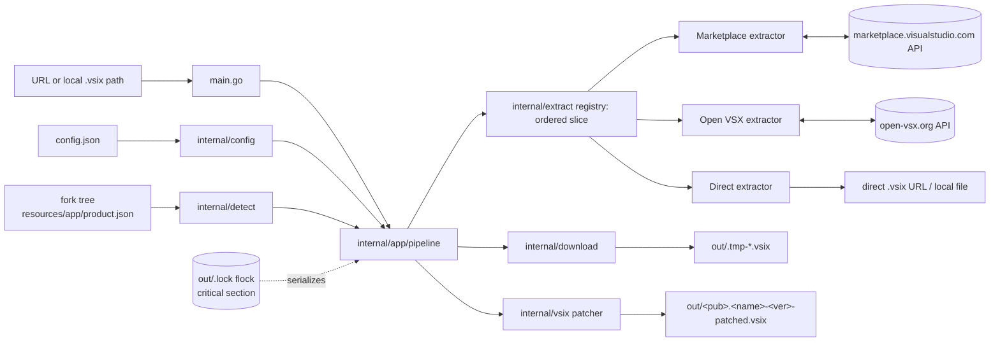

# ARCHITECTURE_PLAN_zen-vsix

## Summary

`zen-vsix` is a single-binary Go CLI that takes **any supported store URL** (or a local `.vsix` path) and produces a VSIX compatible with a local VS Code fork: it resolves the URL to a downloadable `.vsix` via a **yt-dlp-style modular extractor registry**, downloads it, and — only when the extension's `engines.vscode` requirement exceeds the fork's API version — rewrites the zip in a single streaming pass that recompresses **only** `extension/package.json` while byte-copying every other entry raw (no full extraction, no temp tree, O(manifest) memory). The fork's engine version is auto-detected from `product.json` (verified: Antigravity at `/media/jang/home/PortableApp/antigravity/resources/app/product.json` reports `1.107.0`), with `force_engine_version`/`--engine-version` escape hatches. Built because extensions are released against newer engines than forks (Antigravity, Codex, Claude Desktop) ship; the demonstrated `patch.sh` works but does a full unzip→edit→re-zip cycle (recompressing all 22 MB). The architecture was red-teamed by an external browser.chat (claude) agent; its findings are dispositioned at the end, with two "blockers" independently verified false against the Go `archive/zip` source before folding.

## System boundaries

```
zen-vsix <URL-or-local-vsix-path>  [--engine-version X] [-o out] [-k] [--no-patch] [-c config.json]
```



## Data flow and state management

```mermaid
sequenceDiagram
    participant U as User
    participant M as main.go
    participant P as pipeline.Run
    participant E as extractor
    participant D as downloader
    participant V as vsix patcher
    U->>M: zen-vsix <URL>
    M->>P: Run(ctx, URL, Options)
    P->>P: load config.json; lock out/.lock (flock)
    P->>P: resolve engine target<br/>(CLI --engine-version > config force_engine_version > detect fork)
    P->>E: extract.ForURL(URL) → Extract(ctx, URL)
    E-->>P: Artifact{publisher?, name?, version?, directURL?, localPath?}
    alt remote artifact
        P->>D: Download(directURL, out/.tmp-<rand>.vsix)  [429 retry/backoff]
    else local .vsix path
        P->>P: input file is the vsix
    end
    P->>V: ReadManifest(vsix) → engines.vscode
    alt constraint NOT satisfied by fork version
        P->>V: PatchVSIX(src, out/&lt;pub&gt;.&lt;name&gt;-&lt;ver&gt;-patched.vsix)
        P->>V: VerifyPatched(out, wantEngine)  [+ external unzip -t]
    else satisfied, unparseable-constraint, or --no-patch
        P->>P: keep original; no rewrite (rename if remote)
    end
    P->>P: release lock
    P-->>M: Result{patched?, engines before/after, bytes}
    M-->>U: human-readable summary
```

**State management:** deliberately stateless and idempotent. No cache, no DB. Each invocation resolves "latest" fresh, downloads to a unique temp file, and atomically renames into place. A single advisory `flock` on `out/.lock` serializes the patch→rename critical section so concurrent runs don't produce torn state or a TOCTOU collision. The only persistent artifacts are `config.json` (user-owned) and files in `out/`.

## Implementation Blueprint

Module `zen-vsix`, `go 1.23`, single external dep `github.com/Masterminds/semver/v3` (constraint *evaluation*, incl. `||` unions — `golang.org/x/mod/semver` only canonicalizes).

### Ordered build steps

| # | File path | Action | Concrete signature / schema | Depends on | Acceptance criteria ("done when") |
|---|-----------|--------|------------------------------|------------|-----------------------------------|
| 1 | `go.mod` | create | `module zen-vsix`, `go 1.23`, require `github.com/Masterminds/semver/v3 v3.x` | — | `go build ./...`, `go vet ./...` pass on stub tree |
| 2 | `internal/config/config.go` | create | `type Config struct { VSIXPath string \`json:"vscode_path"\`; OutputDir string \`json:"output_dir"\`; ForceEngineVersion string \`json:"force_engine_version"\`; Overwrite bool \`json:"overwrite"\` }`; `func Default() *Config`; `func Load(path string) (*Config, error)` (missing file→`Default`, invalid JSON→error); `func (c \*Config) ResolveOutputDir() (string, error)` — resolves relative to **config.json's dir**, not CWD | 1 | Unit: defaults; relative `output_dir`→config-dir; malformed JSON→error |
| 3 | `internal/detect/version.go` | create | `func DetectEngineVersion(appRoot string) (string, error)`; probes `<root>/resources/app/product.json`, `.../package.json`, `<root>/product.json`, `<root>/package.json`; **distinct errors**: `ErrNoProduct` (no candidate file found at any path) vs returned semver parse error (**file found but `version` empty/garbage**); returns canonical `"1.107.0"` (pre-release retained) | 2 | Unit: Antigravity layout→`1.107.0`; empty dir→`ErrNoProduct`; `version:""`→parse error (not ErrNoProduct) |
| 4 | `internal/extract/extractor.go` | create | `type Artifact struct { Publisher, Name, Version string; DirectURL, LocalPath string; Source string }` (Publisher/Name/Version may be empty, backfilled later); `type Extractor interface { Name() string; Pattern() *regexp.Regexp; Extract(ctx context.Context, rawURL string) (\*Artifact, error) }`; `var ErrNoExtractor = errors.New(...)` | 1 | Compiles; interface documented as the sole extension point (yt-dlp `_VALID_URL` equivalent) |
| 5 | `internal/extract/registry.go` | create | `var all = []Extractor{&marketplaceExtractor{}, &openVSXExtractor{}, &directExtractor{}}` — **explicit ordered slice** (first match wins). `func ForURL(rawURL string) (Extractor, bool)` iterates in order. No per-file `init()` registration, no priority numbers | 4 | Unit: marketplace/openvsx URLs resolve before direct despite source-file order; unknown URL→`(nil,false)`; adding a store = one append to `all` |
| 6 | `internal/extract/direct.go` | create | no priority. `^(https?://.+)\.vsix([?#].*)?$` → `Artifact{DirectURL: url}`; `^file://(.+\.vsix)$` and bare fs path ending `.vsix` (`os.Stat`) → `Artifact{LocalPath: path}`. Version/Name/Publisher intentionally empty (backfilled by pipeline from manifest) | 5 | Unit: http `.vsix`→DirectURL; local path→LocalPath; `foo.txt`→no match |
| 7 | `internal/extract/openvsx.go` | create | `^https://open-vsx\.org/(?:extension\|api)/([^/]+)/([^/]+)(?:/([^/]+))?` (version opt). `Extract`: `GET https://open-vsx.org/api/{pub}/{name}(/{ver})`, decode `{version string, files struct{download string}}` → `Artifact{Publisher, Name, Version, DirectURL: files.download}` | 5 | Unit (`httptest`): item URL→correct; version-specific honored; 404→error |
| 8 | `internal/extract/marketplace.go` | create | Patterns: item page `^https://marketplace\.visualstudio\.com/items\?itemName=([^.]+)\.([^&]+)`; direct API `^.../_apis/public/gallery/publishers/([^/]+)/vsextensions/([^/]+)/([^/]+)/vspackage`. Item page: `POST https://.../extensionquery`, filter `{filterType:7,value:"pub.name"}`, `flags:914`, take `results[0].extensions[0].versions[0]` (latest), pick VSIXPackage `file.source` (prefer `targetPlatform=="universal"`/empty). **Empty `extensions[]`/`versions[]` → `ErrNotFound`, not panic.** API-form→`DirectURL=rawURL`. Sends `User-Agent: zen-vsix/0.1` | 5 | Unit (`httptest`): item→artifact; API passthrough; empty result→`ErrNotFound`; no auth header |
| 9 | `internal/vsix/manifest.go` | create | `type Manifest struct { Name string \`json:"name"\`; Publisher string \`json:"publisher"\`; Version string \`json:"version"\`; Engines map[string]string \`json:"engines"\` }`; `func ReadManifest(r io.ReaderAt, size int64) (*Manifest, error)` — locate `extension/package.json` (**case-insensitive fallback** on entry name; on miss, error lists near-miss entry names), stream with 10 MB cap, JSON-decode; **multi-disk zip → clear "unsupported" error, not raw parse error** | 1 | Unit: parse ok; entry missing→error naming near-misses; `Extension/package.json` (case variant) found |
| 10 | `internal/vsix/patcher.go` | create | `type PatchOptions struct { EngineVersion string }`; `type PatchResult struct { OriginalEngine, PatchedEngine string; Patched bool; EntriesTotal, EntriesPatched int; BytesWritten int64 }`; `func NeedsPatch(constraint, targetVersion string) (bool, error)` — **strip prerelease from `targetVersion` then** `semver.NewConstraint`+`Check` (fork "insider" tags don't reflect engine API; Masterminds `Check` excludes prerelease otherwise → wrong decisions); empty/**whitespace-only** constraint→`(false,nil)`; **unparseable constraint→`(false, nil)`, caller warns + skips patch** (non-destructive default). `func PatchVSIX(ctx,* src,dst string, opts PatchOptions) (*PatchResult, error)` — `zip.OpenReader(src)`, `zip.Create(dst)`, iterate in order; `extension/package.json` decompress→set `engines.vscode="^"+EngineVersion`→recompress (Deflate); all other entries **raw copy**: `fh := *srcFile.FileHeader` (value copy — CreateRaw mutates), `CreateRaw(&fh)`, `OpenRaw()`, `io.Copy`. **Verified against archive/zip source:** bit-3 descriptor is emitted by `fileWriter.close()` in raw mode from CD sizes/CRC; zip64 branches on `CompressedSize64`; reader stores raw name bytes (no EFS transcode). Non-goal (documented comment): `Extra` fields on the recompressed package.json entry are dropped | 9 | **Tests (a–g)**: (a) `^1.109.0`+target `1.107.0`→`Patched=true`, `^1.107.0`; (b) every non-manifest entry byte-identical to source; (c) `^1.90.0`+`1.107.0`→`Patched=false`; (d) `1.107.0-insider`+`^1.85.0`→`Patched=false` (**prerelease normalized**); (e) `1.90.x`, `>=1.85.0 <1.100.0`, `^1.85.0 \|\| ^1.86.0`, whitespace-only → correct; (f) streaming-written (data-descriptor) fixture survives; (g) **synthetic zip64 fixture** survives; **plus: output passes `unzip -t` (independent parser)** |
| 11 | `internal/vsix/verify.go` | create | `func VerifyPatched(vsixPath, wantEngine string) error` — reopen, `ReadManifest`, assert `Engines["vscode"]=="^"+wantEngine`. Also `func VerifyWithExternal(vsixPath string) error` wrapping system `unzip -t` | 10 | Unit: tampered→error; good→nil; external-unzip invocation succeeds on real fixture |
| 12 | `internal/download/downloader.go` | create | `func Download(ctx context.Context, url, dest string) (int64, error)` — GET, redirect cap 10, stream to `dest` (O(1) memory); **on HTTP 429 honor `Retry-After`, retry up to 2× with backoff**; on error remove partial `dest`; `var ErrTooManyRedirects`, `var ErrBadStatus` | 1 | Unit (`httptest`): 302 chain ok; 404→`ErrBadStatus`; 429→retry→success and retry→exhaust->error; partial removed on mid-stream error |
| 13 | `internal/app/pipeline.go` | create | `type Options struct { ConfigPath string; EngineOverride string; OutputDirOverride string; KeepOriginal bool; NoPatch bool }`; `type Result struct { Artifact \*extract.Artifact; OriginalVSIX, PatchedVSIX string; Patched bool; OriginalEngine, PatchedEngine string; BytesWritten int64 }`; `func Run(ctx context.Context, rawURL string, opts Options) (\*Result, error)` — **precedence: `-o` flags win over config `output_dir`; engine `--engine-version` > config `ForceEngineVersion` > detect (error if none available and patch needed)**; acquire `flock` on `ResolveOutputDir()/`..`.lock` for the rewrite+rename critical section (release via defer); download→temp (or LocalPath); `ReadManifest`; **backfill empty `Artifact.Publisher/Name/Version` from Manifest**; `NeedsPatch`; if patch needed→`PatchVSIX`→`VerifyPatched` (+`VerifyWithExternal`); rename final (atomic; `Overwrite=false`→fail if dst exists, checked under lock); `KeepOriginal` keeps temp as `out/<base>.vsix` (**no-op when input was local**); **`--no-patch`** = download only + report "satisfied/skipped", never rewrite; wrap target dir creation, return named error on permission failure | 2,3,5,6,7,8,10,11,12 | E2E: httptest marketplace + temp fork tree→patched in `out/` with `^1.107.0`; local `.vsix`→`-patched` sibling (patch.sh parity); satisfied→untouched, `Patched=false`; `--engine-version` override honored; concurrent `Run` on same dst doesn't corrupt |
| 14 | `main.go` | create | `func main()` — flags `-c/-config`, `--engine-version`, `-o`, `-k/--keep-original`, `--no-patch`, `-h`; single positional arg (URL or local vsix path); **wraps ctx with 60 s timeout**; exit 0 success/1 error with message; `ErrNoExtractor` lists supported URL forms | 13 | Manual: `zen-vsix https://marketplace.visualstudio.com/items?itemName=cdervis.vscode-pi` against real fork tree; `zen-vsix /path/to/x.vsix`; unknown URL→`ErrNoExtractor` |
| 15 | `config.json` | create | `{"vscode_path": "/media/jang/home/PortableApp/antigravity/", "output_dir": "out", "force_engine_version": "", "overwrite": true}` | 2 | `zen-vsix` loads it, no errors |
| 16 | `.gitignore`, `README.md` | create | ignore `out/` and `*.vsix`; README: install, `zen-vsix URL`, config reference, extractor-adding recipe (append one file + one entry in `registry.go` `all`), "patching ≠ API compatibility" warning | 14 | README documents every flag + extension recipe |

### yt-dlp-style extensibility contract

Adding a store = one new file `internal/extract/<source>.go` (a struct implementing `Extractor` with a `Pattern()` regex + `Extract()`) plus **one append** to the `all` slice in `registry.go`. Nothing else changes. The ordered-slice design (vs. earlier `init()`-registered priorities) removes magic-number priority bands and init-order fragility — first match in `all` wins. The pipeline and CLI are source-agnostic.

## Failure modes and mitigations

| Failure mode | Guard (file/function) |
|---|---|
| URL matches no extractor | `extract/registry.go:ForURL`→`ErrNoExtractor`; `main.go` lists supported forms; exit 1 |
| Marketplace/OpenVSX API down / 404 / 429 | `download/downloader.go` (`ErrBadStatus`) + 429 retry/backoff; extractor errors carry `Source` name |
| Marketplace item not found (empty result) | `extract/marketplace.go`→`ErrNotFound` (avoids index-out-of-range panic) |
| Extension has no/empty/whitespace `engines.vscode` | `vsix/patcher.go:NeedsPatch`→`(false,nil)`, pipeline keeps file, reports "no constraint" |
| Constraint unparseable | `NeedsPatch`→`(false,nil)` + caller logs warning + **keeps original** (non-destructive) |
| Fork version detection fails | `detect/version.go` `ErrNoProduct` (no file) vs parse error (empty/garbage version) both named; pipeline suggests `force_engine_version` |
| Fork version has prerelease suffix (`1.107.0-insider`) | `NeedsPatch` strips prerelease before `Check` — correct patch decision (step 10) |
| Corrupt/partial download | temp + atomic `os.Rename`; `Download` removes partials on error; `VerifyPatched` guards before rename |
| Patched zip structurally invalid | `vsix/verify.go` reopen + manifest re-read + **external `unzip -t`**; failure→exit 1, temp untouched |
| Raw-copy zip edge cases (descriptor/zip64/name bytes) | **verified against Go source**; fixtures (f/g) + `unzip -t` regression net in step 10 |
| `Extension/package.json` missing or case-variant | `vsix/manifest.go` case-insensitive fallback + near-miss error listing |
| Multi-disk / pathological zip | `ReadManifest` clear "unsupported" error; 10 MB manifest cap |
| Output dir missing / no write permission | `pipeline.go` creates dir + named permission error message |
| Output collision / concurrent runs | `flock` on `out/.lock` around rewrite+rename; `Overwrite=false`→checked fail under lock |
| Patch installs but breaks at runtime (API absent in fork) | documented limitation; README warning; user's stated goal accepts it |

## Key decisions and alternatives considered

1. **Streaming raw-copy zip rewrite** vs full unzip/rezip (demonstrated `patch.sh`: recompresses ~22 MB, temp dir, ~3× IO) vs byte-level in-place surgery (rejected: `package.json` is Deflate-compressed — verified 89% — so same-size byte patch impossible without recompression shifting offsets). Raw copy = 1 read + 1 write pass, near-zero CPU; soundness independently verified against `archive/zip` source (bit-3 descriptor, zip64, name bytes).
2. **Auto-detect exact fork version → `^1.107.0`** vs conservative floor like the example's `^1.100.0` (rejected: fork `product.json` provably reports `1.107.0`; the floor is a hand-picked constant and can mask genuinely-missing APIs). `force_engine_version`/`--engine-version` override. *(Q1 — adopted per recommendation.)*
3. **Cut `patch_manifest` / `extension.vsixmanifest` rewriting from v1 (YAGNI)** vs carrying it (rejected by external red-team: proven `patch.sh` never touches it, no fork shown to require it). Cheaper to re-add when a fork demands it. *(Resolves earlier Q2 — superseded by this cut.)*
4. **Explicit ordered-slice extractor registry** vs per-file `init()` + `Priority()` (rejected after red-team: priority bands are footguns, init-order is fragile). Simpler and still yt-dlp-shaped — appending to `all` is the extension recipe.
5. **Masterminds/semver v3 with prerelease normalization** vs `golang.org/x/mod/semver` (rejected: constraint *checking* of `^1.85.0 \|\| ^1.86.0` is required; x/mod can't). Red-team caught that `Check` excludes prereleases — now handled by stripping the fork's prerelease.
6. **Unified `zen-vsix URL` CLI, local paths handled by the direct extractor** vs separate `download`/`patch` subcommands (rejected: user asked for `zen-vsix URL`; a local `.vsix` path as "already-downloaded artifact" folds `patch.sh` into the same path with zero extra CLI).
7. **Keep `VerifyPatched` + add external `unzip -t`** — red-team (correctly) recommended keeping the safety net given zip edge cases; strengthened with an independent parser.
8. **Keep `-k/--keep-original` and `Overwrite` as separate flags** (red-team suggested merging into `--safe`; rejected — distinct semantics: preserve the unpatched original vs refuse to clobber an existing patched output; merging is vaguer, not simpler).

## Red-team critique summary (external browser.chat/claude via `zbrowser`, per chat-research skill)

Two rejections below were independently verified against the Go `archive/zip` source before dispositioning (chat-research's "verify before acting" step):

| Red-team point (severity) | Disposition |
|---|---|
| Raw-copy + data-descriptor bit 3 → invalid trailing state (blocker) | **Rejected as blocker; folded defensively.** Source-verified that `fileWriter.close()` (raw path) calls `writeDataDescriptor()` using CD CRC/sizes → descriptor correctly emitted; `OpenRaw` returns payload only but the descriptor is re-emitted on close. Folded: value-copy `FileHeader` (CreateRaw mutates), `unzip -t` acceptance. |
| Zip64 untested (blocker) | **Folded** — synthetic zip64 fixture added (step 10g). |
| EFS bit-11 non-UTF8 name round-trip corruption (major) | **Rejected.** Source-verified reader stores raw name bytes + preserves `Flags` (line 405 computes a convenience `NonUTF8` bool, never rewrites header); raw copy is byte-identical. Guard would be wrong. |
| Prerelease excluded by `Check` → wrong patch decision (blocker) | **Folded** — strip fork prerelease before `Check` (step 10 + test d). Real catch. |
| Constraint syntax gaps (`1.90.x`, `>= <`, `||`, whitespace) untested (major) | **Folded** — test set e expanded. |
| Unparseable-constraint behavior unspecified (minor) | **Folded** — warn + skip patch, keep original (non-destructive). |
| `direct.go` `Version:"parsed-from-manifest-later"` is vague (minor) | **Folded** — explicit pipeline backfill of Name/Publisher/Version from Manifest (step 13). |
| Marketplace empty result → index panic (major) | **Folded** — `ErrNotFound` guard (step 8). |
| Filename collision is check-then-act TOCTOU + concurrency (major) | **Folded** — `flock` on `out/.lock` + atomic rename under lock (step 13). |
| `-o` vs config `output_dir` precedence unspecified (minor) | **Folded** — CLI wins (step 13). |
| HTTP timeout unspecified → CLI hangs (major) | **Folded** — 60 s ctx in `main.go` (step 14). |
| 429 rate-limit no retry story (major) | **Folded** — bounded 2× retry honoring `Retry-After` (downloader). |
| `Extension/package.json` case-variant unhandled (major) | **Folded** — case-insensitive fallback + near-miss error (manifest). |
| `product.json` empty-version vs missing conflated (minor) | **Folded** — distinct errors in `DetectEngineVersion` (step 3). |
| No-publisher field for direct URLs (minor) | **Folded** — output name falls back to basename; fields nullable. |
| `output_dir` no-permission error not surfaced (minor) | **Folded** — named permission error in pipeline. |
| Cut `patch_manifest` from v1 (YAGNI) | **Folded** — removed config field, patcher branch, decision #3. |
| Merge `KeepOriginal`/`Overwrite` into `--safe` | **Rejected** — distinct semantics (decision #8). |
| Priority magic numbers are a footgun (refinement) | **Folded** — replaced with explicit ordered slice in `registry.go` (decision #4). |
| Keep `VerifyPatched` as the safety net | **Folded** — kept + strengthened with external `unzip -t`. |

## Open questions

- **None blocking.** The two red-team "blockers" marked rejected above were resolved by source verification, not left as open questions.
- **Deferred by user (adopted defaults, reversible):** Q1 engine-target = auto-detected `^1.107.0` (override via config/flag); the earlier Q2 (manifest patching) is now moot — cut from v1 per red-team YAGNI and re-addable if a fork requires it.
- **Future scope, explicitly not blocking:** priority/order for next extractors (GitHub Releases is natural third), and `--platform` selection for native extensions on the Marketplace extractor.